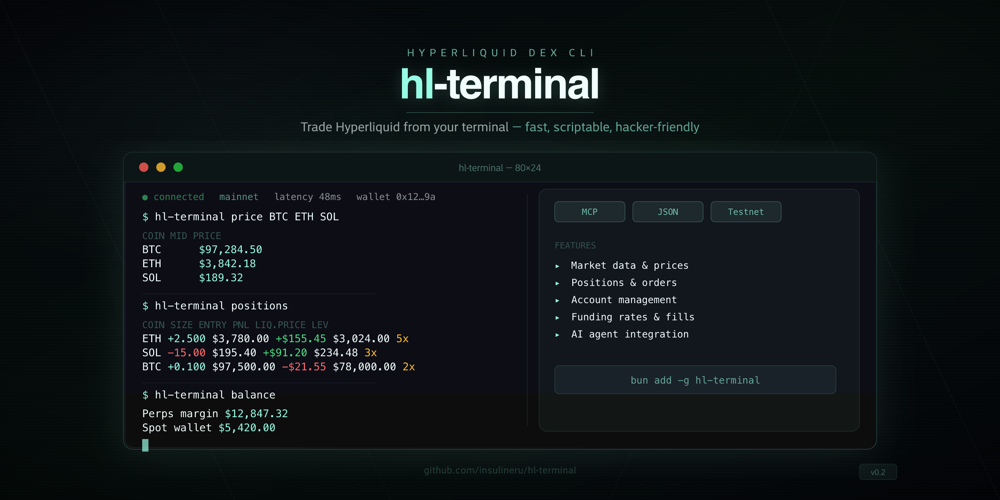

<p align="center">
  
</p>

<p align="center">
  Hyperliquid DEX terminal — read market data, manage accounts, and execute trades from the command line or via AI agent (MCP).
</p>

## Features

- **Market data** — prices, positions, orders, balances, funding rates, fill history
- **Account management** — add, remove, switch accounts with secure local storage
- **Trade execution** — limit/market orders, stop entries, cancel, leverage, take-profit, stop-loss
- **Agent-native** — built-in MCP server mode for AI agent integration
- **Machine-readable** — JSON output, LLM manifest, structured error codes
- **Testnet support** — `--testnet` flag for risk-free testing

## Installation

```bash
# bun (recommended)
bun add -g hl-terminal

# npm
npm install -g hl-terminal
```

## Quick Start

```bash
# Add your first account
hl-terminal account add --name main

# Check BTC price
hl-terminal price BTC

# View your positions
hl-terminal positions

# View your balance
hl-terminal balance

# List available markets
hl-terminal markets

# Place a limit buy order
hl-terminal order create BTC buy 0.001 95000

# Place a market sell order
hl-terminal order create ETH sell 1.5

# Preview a sell stop-market entry (not sent)
hl-terminal order trigger BTC sell 0.5 --trigger 56666 --dry-run

# Set 10x leverage on BTC
hl-terminal position leverage BTC 10
```

## Commands

### Account Management

| Command                              | Description                           |
| ------------------------------------ | ------------------------------------- |
| `hl-terminal account add --name <n>`          | Add account (prompts for private key) |
| `hl-terminal account watch <addr> --name <n>` | Add read-only account (address only)  |
| `hl-terminal account ls`                      | List all accounts                     |
| `hl-terminal account rm <name>`               | Remove an account                     |
| `hl-terminal account switch <name>`           | Switch default account                |

### Market Data

| Command | Description |
| --- | --- |
| `hl-terminal price <coin>` | Current mid-price for a coin |
| `hl-terminal balance` | Perps margin + spot wallet balance |
| `hl-terminal positions` | Open positions with PnL, leverage, liq price |
| `hl-terminal orders` | Open orders with side, size, limit price, trigger price, reduce-only, and TP/SL |
| `hl-terminal markets` | Available markets with metadata |
| `hl-terminal funding [coin]` | Current funding rates or history for a coin |
| `hl-terminal fills [coin]` | Trade history with optional `--coin` filter, time range (`--days`), and pagination |
| `hl-terminal candles <coin>` | OHLCV price history (`--interval 1h`, `--limit 100`) |

> **DEX markets**: All commands support HIP-3 qualified tickers like `xyz:BRENTOIL`, `abc:USA500` in addition to standard coins like `BTC`, `ETH`.

### Trade Execution

| Command | Description |
| --- | --- |
| `hl-terminal order create <coin> <side> <size> [price]` | Place limit (with price) or market (without) order |
| `hl-terminal order trigger <coin> <buy\|sell> <size> --trigger <px>` | Stop-market entry (`--tpsl sl` by default). Add `--limit <px>` for a stop-limit. Size is absolute. `--reduce-only` defaults to false |
| `hl-terminal order cancel <oid>` | Cancel an order by ID, including trigger orders |
| `hl-terminal order cancel-all` | Cancel all open orders (optional `--coin` filter) |

### Position Management

| Command | Description |
| --- | --- |
| `hl-terminal position leverage <coin> <leverage>` | Set leverage (add `--isolated` for isolated margin) |
| `hl-terminal position tp <coin> --price <price>` | Place take-profit trigger on open position |
| `hl-terminal position sl <coin> --price <price>` | Place stop-loss trigger on open position |

### Global Options

| Option | Description |
| --- | --- |
| `--testnet, -t` | Use testnet network |
| `--format <fmt>` | Output format: `toon` (default), `json`, `yaml`, `md`, `jsonl` |
| `--json` | Shorthand for `--format json` |
| `--filter-output <keys>` | Filter output by key paths (e.g. `coin,mid`) |
| `--verbose` | Show full output envelope |
| `--mcp` | Run as MCP server |
| `--llms` | Print LLM-readable command manifest |
| `--schema` | Show JSON Schema for a command |
| `--help` | Show help |
| `--version` | Show version |

### Agent Integration

| Command | Description |
| --- | --- |
| `hl-terminal mcp add` | Register as MCP server for AI agents |
| `hl-terminal skills add` | Sync skill files to agents |
| `hl-terminal completions` | Generate shell completion script |

## MCP Server

hl-terminal works as an [MCP](https://modelcontextprotocol.io) server for AI agents:

```bash
hl-terminal --mcp
```

All commands are exposed as tools that AI agents can call programmatically, including `order trigger`.

`hl-terminal --llms` prints the command manifest (name, arguments, and description) for every command. `hl-terminal skills add` syncs the same command reference to agent skill files. Trigger entries are documented there as `order trigger`:

```bash
# Stop-market: sell 0.5 BTC if mark falls to 56666.
# --slippage 10 matches the Hyperliquid UI (trigger × 0.9). The default is 3, same as market orders.
hl-terminal order trigger BTC sell 0.5 --trigger 56666 --slippage 10

# Stop-limit: buy 0.1 BTC if mark rises to 100000, then rest a limit at 100500.
hl-terminal order trigger BTC buy 0.1 --trigger 100000 --limit 100500

# Take-profit style trigger (buy when price falls). Default --tpsl is sl.
hl-terminal order trigger BTC buy 0.1 --trigger 80000 --tpsl tp --dry-run

# Preview only.
hl-terminal order trigger BTC sell 0.5 --trigger 56666 --dry-run

# Cancel the returned oid. The cancel result includes triggerPx.
hl-terminal order cancel 4242
```

`--tpsl sl` (the default) buys when price rises to the trigger and sells when price falls. `--tpsl tp` is the opposite: a buy must be below the mark and a sell above it. Pass `--force` to place a trigger that is already across the mark. An already-crossed trigger may execute immediately at market or be rejected by Hyperliquid. `--reduce-only` defaults to false, so the order can open or flip a position. `--reduce-only true` and `--reduce-only false` (with a space or `=`) both work, as do `--dry-run true` and `--dry-run false`. `true` and `false` are never read as a price. Position take-profit and stop-loss stay on `position tp` / `position sl`. A `--tpsl tp` trigger is reported as `take-profit-market` or `take-profit-limit`.

`orders` prints `triggerPx` and `triggerCondition` separately from the limit price (a stop-market's limit is the slippage bound), plus `isMarket`, `reduceOnly`, and `tpsl`. A trigger whose exchange size is 0 is shown as `full position`. A partial TP/SL keeps its size.

## Security

Private keys are stored locally at `~/.hyperliquid/config.json` with `0600` file permissions. Keys never leave your machine. Read-only watch accounts are available for monitoring without exposing any keys.

See [SECURITY.md](./SECURITY.md) for the full security policy.

## Contributing

See [CONTRIBUTING.md](./CONTRIBUTING.md) for development setup and guidelines.

## License

[MIT](./LICENSE)
